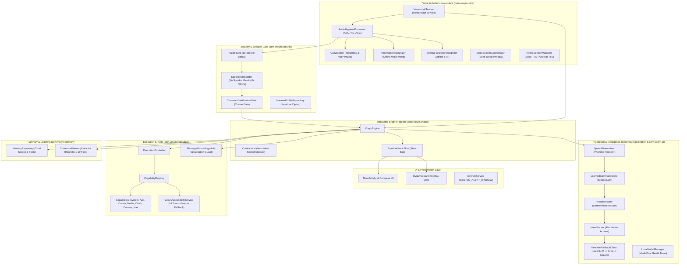

# VOXYN Target Architecture Blueprint

This blueprint defines the target architecture for **VOXYN**, a rootless, voice-first Android AI assistant. It synthesizes the best technical patterns reverse-engineered from the five reference projects while strictly preserving VOXYN's foundational principles:
- **Language & DI:** Kotlin with Koin 3.5+ (no Hilt, no Dagger).
- **Control Flow:** The 10-phase immutable pipeline is the primary control flow:
  $$\text{INPUT} \rightarrow \text{PERCEPTION} \rightarrow \text{INTENT} \rightarrow \text{CONFIDENCE} \rightarrow \text{RISK} \rightarrow \text{DECISION} \rightarrow \text{PLAN} \rightarrow \text{EXECUTE} \rightarrow \text{VERIFY} \rightarrow \text{LEARN}$$
- **Zero Cloud Leaks:** 100% rootless; no Firebase; local-first inference; zero telemetry; Android Keystore sealed secrets.
- **Product Decoupling:** Complete separation of **VOXYN Assistant** (core intelligence, voice, tool pipeline, dynamic overlay) from **VOXYN Shell** (future launcher, widgets, panels, and lockscreen customizer).

---

## 1. Package-Level Architecture Diagram



---

## 2. Component Migration & Evolution Mapping

| Subsystem | Existing VOXYN Component | Proposed Target Component | Architectural Evolution & Reference Pattern |
| :--- | :--- | :--- | :--- |
| **Audio Routing** | Raw `AudioRecord` in `VoiceInputService` | `AudioHygieneProcessor` + `VoiceInputService` | **Adopted from AI Assistant Android:** Direct hardware `AcousticEchoCanceler` and `NoiseSuppressor` attached to `audioSessionId`; route to `VOICE_COMMUNICATION`. |
| **Call Handling** | None (Mic stays open during calls) | `CallWatcher` in `VoiceInputService` | **Adopted from Friday Mobile:** Telephony listener unhooks audio focus on incoming/active calls; automatically re-arms when call ends. |
| **Settle Margins** | 0ms immediate mic restart | Tokenized Settle Delays (`MIC_SETTLE_MS = 200ms`, `FOCUS_SETTLE_MS = 800ms`) | **Adopted from Friday Mobile:** Avoids audio click feedback and hardware race conditions after speech output stops. |
| **Speaker ID** | Heuristic acoustic vector simulation | `SpeakerEmbedder` + `KaldiFbank` (ONNX ResNet34) | **Adopted from Friday Mobile:** Deep neural text-independent speaker embeddings (256-d) running on-device via ONNX Runtime with cosine thresholding ($0.68$). |
| **Voice State** | `ConversationSession` (basic turn cache) | `VoiceSessionCoordinator` with Echo Bleed Window | **Adopted from AI Assistant Android:** 300ms echo suppression window post-TTS prevents self-triggering; clean barge-in cancellation. |
| **Hallucination** | LLM strings passed directly to TTS | `SAYS_ITSELF` + `MessageGrounding` | **Adopted from Friday Mobile:** Consequential actions enforce deterministic capability speech; message bodies must be grounded in user's prompt. |
| **Accessibility** | Basic single-pass node clicker | `VoxynAccessibilityService` with Retry & Gesture Fallback | **Adopted from Sanna:** Progressive 50–500ms retries for cold-launch app rendering; `dispatchGesture` fallback if view consumption fails; overlay exclusion. |
| **Execution Recovery**| Blind 1-time repeat of failed step | `SelfHealingExecutor` with Screen Context | **Adopted from Open Jarvis:** Screen re-inspection upon step failure feeds back to planner to construct an alternate action instead of repeating errors. |
| **Model Fallback** | Hardcoded Claude fallback | `ProviderFallbackChain` with 429 Cooldowns | **Adopted from Open Jarvis:** Dynamic multi-provider rotation (Local MediaPipe $\rightarrow$ Groq Fast $\rightarrow$ Claude) with exponential cooldown. |
| **Learned Bypass** | None | `LearnedCommandStore` in `MemoryRepository` | **Adopted from Friday Mobile:** Successfully resolved LLM tool calls are recorded and executed locally on repeat in $<5\text{ms}$. |
| **Memory Extract** | Manual `"remember that..."` regex only | `ContextualMemoryExtractor` | **Adapted from AI-Buddy:** Heuristic pattern matching automatically extracts personal info, preferences, and relations into tiered facts without LLM tokens. |
| **Overlay UI** | Initial `DynamicIsland.kt` | Animated Dynamic Island with Waveform Feedback | **Refined for VOXYN:** Real-time RMS audio metering, smooth spring transitions between 8 discrete execution states. |

---

## 3. Subsystem Architecture Specifications

### 3.1 Audio Infrastructure & Microphone Lifecycle
1. **Source:** `MediaRecorder.AudioSource.VOICE_COMMUNICATION` provides acoustic echo cancellation at the HAL driver level.
2. **Hardware Effect Chains:**
   ```kotlin
   if (AcousticEchoCanceler.isAvailable()) {
       echoCanceler = AcousticEchoCanceler.create(audioSessionId)?.apply { enabled = true }
   }
   if (NoiseSuppressor.isAvailable()) {
       noiseSuppressor = NoiseSuppressor.create(audioSessionId)?.apply { enabled = true }
   }
   ```
3. **Audio Routing:** Hands-free operation configures `AudioManager.MODE_IN_COMMUNICATION` with `isSpeakerphoneOn = true`.
4. **Lifecycle Coordination:**
   - **TTS Start:** Pause audio capture, set `lastTtsStartTime = currentTimeMillis()`.
   - **TTS End:** Wait `MIC_SETTLE_MS = 200ms`, then resume wake-word / continuous recognition.
   - **Telephony Event:** On `CALL_STATE_RINGING` or `CALL_STATE_OFFHOOK`, immediately release mic; re-arm only on `CALL_STATE_IDLE`.

### 3.2 Deep Neural Speaker Verification
1. **Model:** WeSpeaker's `voxceleb_resnet34_LM` stored in `assets/speaker_embedding.onnx` (~20MB float16).
2. **Feature Pipeline:**
   - Input: 16 kHz mono 16-bit PCM. Minimum audio duration: 500ms (8,000 samples).
   - Compute Kaldi mel-filterbanks: 80 bins, 25ms frame length, 10ms hop length.
   - Subtract cepstral mean per utterance.
   - Tensor Shape: `[1, num_frames, 80]`.
3. **Inference:** Single-threaded ONNX Runtime session outputs a 256-dimensional float vector.
4. **Verification Gate:**
   $$\text{Cosine Similarity} = \frac{\mathbf{u} \cdot \mathbf{v}}{\|\mathbf{u}\|_2 \|\mathbf{v}\|_2} \ge 0.68$$
   If below threshold, sensitive actions (`SEND_MESSAGE`, `CALL_CONTACT`, `LOCK_PHONE`) are rejected with `UNKNOWN_SPEAKER`.

### 3.3 Immutable Pipeline Integration
The pipeline remains strictly immutable and unidirectional:
```
INPUT (Raw Audio / Text)
  │
PERCEPTION (SpeechNormalizer: phonetic app name resolution, number normalization)
  │
INTENT (LearnedCommandStore match -> RequestRouter -> IntentRouter -> ModelProvider)
  │
CONFIDENCE (Weighted formula: intent.confidence * 0.7 + memory.trustScore * 0.3)
  │
RISK (Package/Action classification: HIGH_RISK = 0.9f, LOW_RISK = 0.1f)
  │
DECISION (Execute | AwaitingConfirmation | AwaitingClarification | Rejected)
  │
PLAN (Deterministic ExecutionPlan: ActionStep sequence)
  │
EXECUTE (ExecutionController dispatches to CapabilityRegistry; Self-Healing recovery)
  │
VERIFY (Verifiable post-condition checks -> VerificationOutcome)
  │
LEARN (Record trust outcome; LearnedCommandStore caching; ContextualMemoryExtractor)
```

### 3.4 Tool Registry & Anti-Hallucination Policy
1. **Strict Capability Contracts:** Every capability implements:
   ```kotlin
   interface Capability {
       val id: String
       val supportedActions: Set<String>
       suspend fun execute(step: ActionStep): PhaseResult<String>
       suspend fun verify(step: ActionStep, result: String): VerificationOutcome
   }
   ```
2. **Anti-Hallucination Policy (`SAYS_ITSELF`):**
   - For any action in `setOf("CALL_CONTACT", "SEND_MESSAGE", "SEND_WHATSAPP_MESSAGE")`, the returned status string from the capability is used verbatim for TTS. The LLM is never allowed to summarize or restate whether a message was delivered.
3. **Spoken Grounding:**
   ```kotlin
   fun isGroundedInSpokenPrompt(messageText: String, rawSpokenInput: String): Boolean {
       val cleanMessage = messageText.lowercase().trim()
       val cleanInput = rawSpokenInput.lowercase().trim()
       return cleanInput.contains(cleanMessage) || calculateWordOverlap(cleanMessage, cleanInput) >= 0.75f
   }
   ```

### 3.5 Model Provider Abstraction & Fallback Chain
```kotlin
interface ModelProvider {
    val name: String
    val isLocal: Boolean
    suspend fun resolveIntent(prompt: String, context: String): Result<IntentResult>
    suspend fun generateText(prompt: String, context: String): Result<String>
}
```
**Fallback Hierarchy:**
1. `LocalMediaPipeProvider` (Zero network latency, 100% offline).
2. If offline model unavailable or confidence low $\rightarrow$ `GroqFastProvider` (Llama 3.1 8B Instant, ~300ms latency).
3. If rate-limited (HTTP 429) or failed $\rightarrow$ `ClaudeProvider` (Anthropic Claude 3.5 Sonnet).
4. Cooldown tracker marks failing providers with a 60-second cooldown timer before retry.

---

## 4. Separation of VOXYN Assistant & VOXYN Shell

To maintain extreme architectural modularity and ensure stability, the codebase strictly separates **VOXYN Assistant** from **VOXYN Shell**:

```
com.voxyn/
├── assistant/         # CORE VOXYN ASSISTANT
│   ├── engine/        # Immutable 10-phase pipeline
│   ├── voice/         # AudioRecord, ASR, Vosk, TTS, Settle margins
│   ├── security/      # ONNX Speaker verification & Keystore ciphers
│   ├── perception/    # SpeechNormalizer, ContextEngine, Accessibility
│   ├── execution/     # Capabilities, CapabilityRegistry, Verification
│   ├── ai/            # ModelProvider, LocalModelManager, ProviderFallbackChain
│   ├── memory/        # MemoryRepository, LearnedCommands, ContextualExtractor
│   └── overlay/       # DynamicIsland floating window HUD
│
└── shell/             # FUTURE VOXYN SHELL (Completely Independent Layer)
    ├── launcher/      # Custom home launcher integration & app drawer
    ├── widgets/       # Glance / RemoteView home screen widgets
    ├── panels/        # Edge panels, quick glance assistant drawers
    ├── gestures/      # Custom system-wide gesture hooks & edge swipes
    └── lockscreen/    # Lockscreen clock, reactor widget, customization
```

**Boundary Rules:**
- The **Assistant** has zero dependencies on the **Shell**. It operates as a headless background voice service and overlay.
- The **Shell** consumes the Assistant via Android standard Broadcasts, Koin shared domain modules, and `PipelineEvent` flows.
- Disabling or removing the Shell leaves 100% of VOXYN Assistant's voice, intelligence, and execution capabilities intact.
