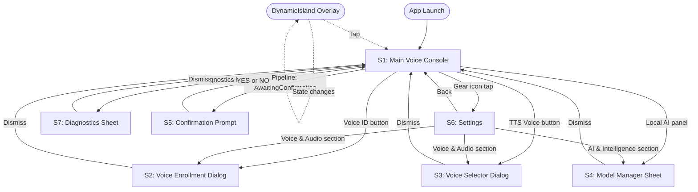

# VOXYN Assistant UI Design Specification
**Prompt 3 Deliverable — Design Phase Blueprint (No source code modified)**

Grounded in source inspection:
- [`MainScreen.kt`](file:///c:/Users/srsur/Downloads/Voxyn/Voxyn2/app/src/main/java/com/voxyn/ui/MainScreen.kt) — 1,269 lines, existing Compose UI
- [`DynamicIsland.kt`](file:///c:/Users/srsur/Downloads/Voxyn/Voxyn2/app/src/main/java/com/voxyn/overlay/DynamicIsland.kt) — Canvas-based overlay, 313 lines
- [`Theme.kt`](file:///c:/Users/srsur/Downloads/Voxyn/Voxyn2/app/src/main/java/com/voxyn/ui/theme/Theme.kt) — 4 existing color tokens

> **Product distinction preserved throughout:**
> - **VOXYN Assistant** — rootless, voice-first AI assistant (this spec)
> - **VOXYN Shell** — future launcher, widgets, panels (not in scope here)

---

## 0. Design Reference Mockups

### Main Screen (Current Design Direction)


### Dynamic Island States


### Settings Screen


---

## 1. Theme Tokens

The existing [`Theme.kt`](file:///c:/Users/srsur/Downloads/Voxyn/Voxyn2/app/src/main/java/com/voxyn/ui/theme/Theme.kt) defines 4 tokens. Extend with the following **complete token set** (additive — no breaking changes):

```kotlin
// ── Existing (preserve exactly) ──────────────────────────────────────────
val VoxynCyan    = Color(0xFF00E5FF)  // Primary interactive / accent
val VoxynBg      = Color(0xFF080C10)  // App background
val VoxynSurface = Color(0xFF0F1419)  // Card / dialog surface
val VoxynText    = Color(0xFFE0F7FA)  // Primary text

// ── New Semantic Tokens (add to Theme.kt) ────────────────────────────────
val VoxynGreen   = Color(0xFF00E676)  // Success / enrolled / active
val VoxynAmber   = Color(0xFFFFAB00)  // Warning / confirmation / thinking
val VoxynRed     = Color(0xFFFF1744)  // Error / danger / reject
val VoxynBlue    = Color(0xFF64B5F6)  // Info / diagnostics
val VoxynDim     = Color(0xFF546E7A)  // Inactive / disabled / placeholder

// ── Glassmorphism Surface Variants ────────────────────────────────────────
val VoxynGlassBg       = Color(0xCC0F1419)  // Surface at 80% opacity (glass card)
val VoxynGlassBorder   = Color(0x3300E5FF)  // Cyan at 20% (glass card border)
val VoxynGlassBorderStrong = Color(0x8000E5FF) // Cyan at 50% (focused border)

// ── Dynamic Island State Colors ───────────────────────────────────────────
val IslandIdleBorder    = Color(0x1A00E5FF)  // 10% cyan hairline
val IslandListenBorder  = Color(0xFF00E5FF)  // 100% cyan glow
val IslandThinkBorder   = Color(0xFFFFAB00)  // amber
val IslandExecBorder    = Color(0xFF00E676)  // green
val IslandConfirmBorder = Color(0xFFFFAB00)  // amber
val IslandSpeakBorder   = Color(0xFF00E676)  // green

// ── Typography Scale ──────────────────────────────────────────────────────
// Font: Inter (add to fonts/ resource or via downloadable font)
// Display  : 24sp Bold    — Screen titles
// Title    : 18sp SemiBold — Section headers
// Body     : 14sp Regular  — Conversation text
// Caption  : 11sp Regular  — Status labels, metadata
// Mono     : 11sp Monospace — Diagnostics, log panels
// Micro    : 9sp Regular   — Island label text, timestamps

// ── Spacing & Shape ───────────────────────────────────────────────────────
// cornerSmall  : 8.dp   (buttons, chips, input)
// cornerMedium : 16.dp  (cards, dialogs)
// cornerLarge  : 24.dp  (bottom sheets)
// cornerIsland : 18.dp  (Dynamic Island pill = fully rounded)
// spacingXS    : 4.dp
// spacingS     : 8.dp
// spacingM     : 16.dp
// spacingL     : 20.dp
// spacingXL    : 24.dp
```

---

## 2. Screen Inventory

| ID | Screen Name | Route / Nav | Entry Point |
|:---:|:---|:---|:---|
| S1 | **Main / Voice Console** | Root | App launch / overlay tap |
| S2 | **Voice Enrollment Dialog** | Modal over S1 | "Voice ID" button |
| S3 | **Voice Selector Dialog** | Modal over S1 | "TTS Voice" button |
| S4 | **Model Manager** | Sheet from S1 or Settings | "Local AI" panel |
| S5 | **Confirmation Prompt** | Overlay on current screen | Pipeline DECISION → AwaitingConfirmation |
| S6 | **Settings** | Full screen from S1 | Settings gear icon |
| S7 | **Diagnostics Sheet** | Bottom sheet from S1 or S6 | "Diagnostics" button |

> **Screens NOT designed here (VOXYN Shell scope):** Launcher, home widgets, edge panels, lockscreen clock.

---

## 3. Navigation Flow



**Navigation rules:**
- S1 is the always-running root; it never finishes.
- Dialogs (S2, S3, S5) are `AlertDialog` / Compose overlays — not separate Activities.
- S4 and S7 are `ModalBottomSheet` — slide-up panels.
- S6 is a full `BackHandler`-aware screen pushed onto the Compose navigation stack.
- The `DynamicIsland` overlay (`SYSTEM_ALERT_WINDOW`) is always on top, independent of navigation.

---

## 4. Screen Specifications

### S1: Main Voice Console

**Purpose:** The primary user-facing surface for voice interaction and pipeline monitoring.

**Layout structure (top → bottom):**
```
TopBar (56dp)
  └─ "VOXYN" wordmark (24sp Bold, white) + Status dot + Settings icon

DynamicIslandArea (60dp, centered)
  └─ DynamicIsland View (from OverlayService, not Compose — shown in MainScreen as mirrored state)

PhaseBar (48dp)
  └─ 10 phase dots, horizontal, scrollable on narrow screens

ConversationPanel (weight: 1f — fills remaining space)
  └─ LazyColumn of MessageBubble composables

ToolbarRow (36dp)
  └─ [Voice ID] [TTS Voice] [Diagnostics] — three OutlinedButton chips

CommandInputArea (72dp)
  └─ OutlinedTextField (weight: 1f) + SendButton (40dp) + MicButton (56dp circular)
```

**Existing components to preserve (confirmed in MainScreen.kt):**
- `Header()` composable — shows wordmark + running state
- `PhaseBar()` composable — 10-dot pipeline phase indicator
- `LogPanel()` composable — scrollable log/message list
- `CommandInput()` composable — text field + mic + send
- `LocalAiPanel()` composable — model download status
- `VoiceSelectorDialog()` composable
- `VoiceProfilesDialog()` composable

**Proposed changes:**
- Replace `LogPanel` with `ConversationPanel` using alternating message bubbles (user right, VOXYN left) instead of raw log text.
- Add `AnswerProvenanceChip` (inline, below VOXYN responses) showing source: LOCAL / GROQ / CLAUDE / CACHED.
- Add `LiveTranscriptBanner` (animated, appears above CommandInput during LISTENING state): shows real-time partial recognition text in dim cyan.
- Remove or collapse `LocalAiPanel` into Settings → Model Manager sheet.

**Existing color constants used (confirmed MainScreen.kt:L38-41):**
```kotlin
private val SUCCESS_COLOR = Color(0xFF00E676)  // → map to VoxynGreen
private val ERROR_COLOR   = Color(0xFFFF1744)  // → map to VoxynRed
private val WARN_COLOR    = Color(0xFFFFAB00)  // → map to VoxynAmber
private val DIM_COLOR     = Color(0xFF546E7A)  // → map to VoxynDim
```
These match the proposed tokens exactly — no color changes needed.

---

### S2: Voice Enrollment Dialog

**Purpose:** Enroll new speaker profiles for voice identity verification.

**Type:** `AlertDialog` (existing `VoiceProfilesDialog` composable)

**Content:**
- Header: "Voice Identity" title, profile count subtitle "1 of 25 slots used"
- Profile list: each row shows [Name] [Sample count] [Delete icon]
- "Add Profile" button → opens enrollment flow:
  - Name input field
  - "Owner" vs "Guest" toggle (owner gets high-risk action access)
  - Recording prompt: "Say 'VOXYN, activate' 3 times"
  - Progress indicator (1/3, 2/3, 3/3)
  - "Or import audio file" secondary option
- Enrollment feedback states: RECORDING (red pulsing dot), PROCESSING (amber spinner), SUCCESS (green checkmark), FAILED (red X)

**Interaction states:**
- Empty state: warning amber banner "No voice enrolled — high-risk actions disabled"
- Enrolled state: green banner "Voice verification active"
- During enrollment: mic recording animation (pulsing ring)

---

### S3: Voice Selector Dialog

**Purpose:** Choose the TTS voice persona.

**Type:** `AlertDialog` (existing `VoiceSelectorDialog` composable)

**Content:**
- Title: "Assistant Voice"
- List of voice options with:
  - Radio button (cyan when selected)
  - Name: "Jarvis", "Friday", "Cadence", "Expressive", "Default"
  - Preview button (▶ icon) — plays sample phrase
  - Small badge: "Local" (green) or "Online" (cyan)
- "Open Voice Identity" link at bottom (navigates to S2)

---

### S4: Model Manager Sheet

**Purpose:** View, download, and manage local AI models.

**Type:** `ModalBottomSheet`

**Content sections:**
1. **Speech Recognition:** "Parakeet 0.6B INT8" — size, status (Downloaded / Downloading X% / Not Downloaded), [Download] / [Delete] buttons
2. **Local LLM:** "Gemma 2B Q4" — size, status, [Download] / [Delete] buttons
3. **Speaker Embedding:** "ResNet34 (CC-BY-4.0)" — size, status (future Phase 9)
4. **Provider Chain Preview:** Visual chain showing `Local → Groq → Claude` with health status dots

---

### S5: Confirmation Prompt

**Purpose:** User confirmation for high-risk actions before the pipeline executes.

**Type:** Glass overlay card (Compose `Box` over MainScreen content, semi-transparent backdrop)

**Content:**
- Amber border glow card (centered, 320dp wide)
- Icon: ⚠️ amber warning
- Action description: "Send WhatsApp message to **Alice Chen**?"
- Message preview in a glass bubble: "Happy Birthday!"
- Two buttons: [CANCEL] (dim outlined) + [SEND] (green filled)
- Countdown progress arc (15s auto-cancel) at card top-right corner
- Small text: "Auto-cancelled in 12s"

**Interaction:**
- Tap outside → cancel (same as NO)
- Voice: "Yes" / "Confirm" → execute; "No" / "Cancel" → reject
- Timeout → auto-cancel with haptic feedback

---

### S6: Settings

**Purpose:** Configuration for voice, AI providers, privacy, and diagnostics.

**Type:** Full-screen Compose navigation destination

**Sections (glass cards):**
1. **Voice & Audio**
   - TTS Voice → opens S3
   - Voice Identity → opens S2 (shows enrolled count in green/amber)
   - Wake-word Sensitivity (Slider: 0.3–0.9, default 0.5)
   - Echo Cancellation (Switch, default ON)
   - Call Interruption (Switch, default ON)

2. **AI & Intelligence**
   - AI Provider Chain → opens provider config screen (future)
   - Local LLM Model → opens S4
   - ASR Model → opens S4
   - Learned Command Cache → shows count, [Clear Cache] button
   - Memory Extraction (Switch, default ON)
   - Provider Fallback Timeout (Stepper: 10s–120s, default 60s)

3. **Privacy & Security**
   - Speaker Verification Gate (Switch, amber when ON)
   - Conversation History (Switch, cyan when ON)
   - Memory & Learning (Switch, cyan when ON)
   - Clear Conversation History → destructive confirmation dialog
   - Delete All Voice Data → destructive confirmation dialog (red text)

4. **About**
   - Version: VOXYN v2.0.0
   - Open Source Licenses (link)
   - Export Diagnostic Report

---

### S7: Diagnostics Sheet

**Purpose:** Technical pipeline diagnostics for developer / power users.

**Type:** `ModalBottomSheet`

**Content:**
- Monospace log dump (11sp, dark surface, scrollable)
- Voice diagnostics: microphone state, last RMS dB, audio source, AEC status
- Pipeline last run: phase timings in ms
- Provider health: each provider's last status code + cooldown remaining
- Speaker gate: last similarity score
- Memory stats: learned command count, memory fact count
- [Copy to Clipboard] + [Share] buttons

---

## 5. Dynamic Island — Complete State Specification

The `DynamicIsland.kt` View uses `Canvas` drawing. The existing `IslandState` enum at [`DynamicIsland.kt:L21-23`](file:///c:/Users/srsur/Downloads/Voxyn/Voxyn2/app/src/main/java/com/voxyn/overlay/DynamicIsland.kt#L21-L23):
```kotlin
enum class IslandState {
    IDLE, LISTENING, PROCESSING, SPEAKING, CONFIRMATION, SUCCESS, ERROR
}
```

**Proposed extension (add `EXECUTING` to enum):**
```kotlin
enum class IslandState {
    IDLE, LISTENING, PROCESSING, SPEAKING, EXECUTING, CONFIRMATION, SUCCESS, ERROR
}
```

### State Specifications

| State | Trigger | Width | Border Color | Interior | Animation |
|:---:|:---|:---:|:---|:---|:---|
| **IDLE** | Pipeline complete / app idle | 120dp | `IslandIdleBorder` (#1A00E5FF hairline) | Green dot 6dp + "VOXYN" cyan 9sp | Slow heartbeat pulse (2s cycle, +1dp expand) |
| **LISTENING** | `VoiceInputService` microphone active | 200dp | `IslandListenBorder` (#FF00E5FF, 2dp) | Cyan concentric rings + 5-bar RMS waveform | Rings expand out 8dp on each pulse; bars animate to current RMS |
| **PROCESSING** | `INTENT` / `CONFIDENCE` / `RISK` phases | 200dp | `IslandThinkBorder` (#FFAB00, 2dp) | "Thinking..." white 11sp + amber arc spinner right | Arc rotates 360° / 600ms; text fades in |
| **EXECUTING** | `EXECUTE` phase, each ActionStep | 220dp | `IslandExecBorder` (#00E676, 1.5dp) | Step description text white 11sp + "2/3" cyan badge | Badge counter updates per step; green shimmer left-to-right |
| **CONFIRMATION** | `DECISION → AwaitingConfirmation` | 260dp | amber 2.5dp + glow shadow | "Send to Alice?" white 13sp Bold + YES/NO chips | Amber border pulses; countdown arc drains; 15s auto-cancel |
| **SPEAKING** | TTS playback active | 200dp | `IslandSpeakBorder` (#00E676, 2dp) | Green waveform bars (8 bars, RMS-driven from TTS amplitude) | Bars animate to audio amplitude; BPM synced to speech rhythm |
| **SUCCESS** | `VERIFY → Success` | 160dp | green 1.5dp | Green checkmark ✓ centered | Scale-in spring animation (0→1 in 300ms) |
| **ERROR** | `VERIFY → Failure` / Phase failed | 160dp | red 1.5dp | Red ✗ + error text 9sp | Shake animation (4 cycles, 8dp horizontal) |

### Island Animation Principles
- Width transitions: `ValueAnimator` with `AccelerateDecelerateInterpolator`, duration 250ms.
- All draw calls on main thread via `Handler(Looper.getMainLooper())`.
- RMS updates from `VoiceInputService` via `Handler.post()` — never direct IO thread call.
- Existing implementation in [`DynamicIsland.kt:L68-80`](file:///c:/Users/srsur/Downloads/Voxyn/Voxyn2/app/src/main/java/com/voxyn/overlay/DynamicIsland.kt#L68-L80) uses `pulseRunnable` pattern — extend this for all states.

---

## 6. Reusable Component Specifications

### 6.1 `MessageBubble` Composable

```kotlin
// Replace raw log text in LogPanel with proper chat bubbles
@Composable
fun MessageBubble(
    text: String,
    isUser: Boolean,
    timestamp: Long,
    provenance: String? = null,     // "LOCAL" | "GROQ" | "CLAUDE" | "CACHED"
    isPartial: Boolean = false       // true = live transcription, text dims and italicizes
)
```

**User bubble (right-aligned):**
- Background: `VoxynSurface` + blue tint overlay at 20% opacity (`Color(0x3300E5FF)`)
- Corner: `RoundedCornerShape(16.dp, 16.dp, 4.dp, 16.dp)` (bottom-right flat)
- Text: `VoxynText` 14sp Regular
- Timestamp: `VoxynDim` 9sp, right-aligned below bubble

**VOXYN bubble (left-aligned):**
- Leading: 6dp cyan dot (pulsing when streaming)
- Background: `VoxynGlassBg` + `VoxynGlassBorder` 1dp
- Corner: `RoundedCornerShape(4.dp, 16.dp, 16.dp, 16.dp)` (top-left flat)
- Text: `VoxynText` 14sp Regular
- Provenance chip: small pill below bubble — "via LOCAL" / "via GROQ" etc in 9sp `VoxynDim`

### 6.2 `PhaseBar` Composable (existing, enhance)

```kotlin
@Composable
fun PhaseBar(
    currentPhase: Int,   // -1 = idle, 0-9 = active phase index
    isRunning: Boolean,
    failedPhase: Int = -1   // NEW: highlight failed phase in red
)
```

**Each phase dot:**
- Size: 8dp diameter circle
- Active: filled `VoxynCyan`, glow shadow 4dp
- Completed: filled `VoxynCyan` at 40% opacity
- Future: filled `VoxynDim` at 30% opacity
- Failed: filled `VoxynRed`, shake animation
- Phase label below dot: 7sp `VoxynDim` (truncated to fit; full name on long press tooltip)

### 6.3 `LiveTranscriptBanner` Composable (NEW)

```kotlin
@Composable
fun LiveTranscriptBanner(
    partialText: String,    // From VoiceSessionCoordinator partial results
    isVisible: Boolean
)
```

- Appears with `AnimatedVisibility(slideInVertically + fadeIn)` from bottom of PhaseBar
- Background: `VoxynGlassBg`, border `VoxynGlassBorderStrong` 1dp
- Text: `VoxynCyan` 13sp Italic (partial transcript, live updating)
- Leading icon: animated mic waveform mini (2 bars, RMS-driven)
- Dismisses automatically when `isVisible = false` (LISTENING → PROCESSING transition)

### 6.4 `ProviderChainChip` Composable (NEW)

```kotlin
@Composable
fun ProviderChainChip(
    providerName: String,     // "LOCAL" | "GROQ" | "CLAUDE" | "CACHED"
    latencyMs: Long?,
    isCoolingDown: Boolean = false
)
```

- Compact pill: 8dp corners, 4dp H padding, 24dp height
- LOCAL: `VoxynGreen` text + "LOCAL" label
- GROQ: `VoxynCyan` text + "GROQ ~300ms" label
- CLAUDE: `Color(0xFF9B59B6)` purple text + "CLAUDE"
- CACHED: `VoxynAmber` text + "CACHED <5ms"
- Cooling down: `VoxynDim` + "COOLDOWN 45s" strikethrough

### 6.5 `ConfirmationOverlay` Composable (NEW)

```kotlin
@Composable
fun ConfirmationOverlay(
    intent: IntentResult,
    timeoutMs: Long = 15_000,
    onConfirm: () -> Unit,
    onCancel: () -> Unit
)
```

- Semi-transparent scrim over full screen
- Card: 320dp wide, `VoxynGlassBg`, `IslandConfirmBorder` 2dp, 24dp corners, amber glow shadow
- CountdownArc: arc drains from 100% → 0% over `timeoutMs`; auto-calls `onCancel` at 0

---

## 7. Interaction States & Accessibility

### 7.1 Microphone Button States

| State | Visual | Touch |
|:---|:---|:---|
| **Default** | 56dp circle, `VoxynCyan` border 2dp, mic icon white | Tap = activate recording |
| **Active** | 56dp circle, `VoxynCyan` filled bg, white mic, pulsing glow ring | Tap = stop recording |
| **Disabled** | 56dp circle, `VoxynDim` border, mic icon dim 40% | No touch response |
| **Processing** | 56dp circle, amber spinner ring overlaid, mic dim | Disabled during pipeline |

### 7.2 Accessibility Requirements

All new components must satisfy:
- **Content descriptions:** Every icon-only button has `contentDescription` in English.
  - Mic button: `"Activate voice input"` / `"Stop voice input"`
  - Send button: `"Send command"`
  - Settings: `"Open settings"`
- **Minimum touch target:** 48×48dp for all interactive elements (Android accessibility guideline).
- **Color independence:** No information conveyed by color alone — always add an icon or text label.
  - E.g., SUCCESS state: green ✓ icon + "Done" text, not just green color.
- **TalkBack compatibility:**
  - `PhaseBar` announces: "Pipeline in {phaseName} phase"
  - `ConfirmationOverlay` announces: "Confirmation required: {actionDescription}. Say yes or no, or tap buttons."
- **Reduced motion:** Check `LocalContext.current.resources.configuration.uiMode` — if accessibility preference for reduced motion is set, disable non-essential animations (pulse, particles, shimmer).

---

## 8. Google Stitch Prompts

These prompts are ready for use with Google Stitch (AI UI generation tool). Each produces a starting point for native Android implementation.

### Stitch Prompt 1: Main Voice Console
```
Create an Android Jetpack Compose screen for a voice AI assistant called VOXYN.

Dark theme: background #080C10, surface #0F1419, primary accent #00E5FF (cyan), text #E0F7FA.

Layout (top to bottom):
1. Top bar: "VOXYN" in bold white 24sp left, green status dot, settings gear icon right.
2. Pipeline phase tracker: 10 small circles horizontally labeled INPUT through LEARN. Active circle glows cyan. Completed dim teal. Future dark grey.  
3. Conversation area (fills available space): LazyColumn with chat bubbles. User messages right-aligned in semi-transparent blue glass bubbles. Assistant messages left-aligned in dark glass cards with a cyan dot on the left.
4. Bottom toolbar row: three small OutlinedButton chips — "Voice ID" (green border), "Jarvis" (cyan border), "Diagnostics" (blue border).
5. Input row: OutlinedTextField with cyan border glow (weight 1f), send arrow button, large 56dp circular mic button with pulsing cyan glow ring.

Glass card style: RoundedCornerShape(16.dp), 1dp border at Color(0x3300E5FF), background Color(0xCC0F1419).
All text uses Inter font. No hardcoded strings — use string resources.
```

### Stitch Prompt 2: Dynamic Island Overlay
```
Create an Android Canvas-based View called DynamicIsland.

This is a floating pill-shaped overlay that sits at the top center of the screen above all other apps. It must work as a SYSTEM_ALERT_WINDOW overlay.

States and their visual designs:
- IDLE: 120dp wide, 36dp tall, fully rounded, black background, hairline cyan border at 10% opacity, small green dot left, "VOXYN" in cyan 9sp centered.
- LISTENING: 200dp wide, cyan 2dp glowing border, animated cyan concentric rings expanding out, 5 vertical audio bars in center animated to microphone amplitude.
- THINKING: 200dp wide, amber border 2dp, "Thinking..." white text left, amber arc spinner right that rotates continuously.
- EXECUTING: 220dp wide, green border 1.5dp, action text white left, cyan step counter badge "2/3" right in a circle.
- CONFIRMATION: 260dp wide, amber 2.5dp border with glow shadow, "Action?" white text bold, YES chip green + NO chip red right side, countdown arc draining at top right.
- SPEAKING: 200dp wide, green border 2dp, 8 vertical waveform bars in green animated to TTS audio amplitude.

Width transitions use ValueAnimator with AccelerateDecelerateInterpolator over 250ms.
All drawing done on Canvas. Color constants follow VOXYN theme: VoxynCyan #00E5FF, VoxynGreen #00E676, VoxynAmber #FFAB00, VoxynRed #FF1744.
```

### Stitch Prompt 3: Settings Screen
```
Create an Android Jetpack Compose Settings screen for VOXYN AI assistant.

Dark theme background #080C10. Full screen with TopAppBar showing back arrow and "Settings" title in white.

Content is a LazyColumn of glass-morphism SectionCard composables. Each SectionCard has:
- Semi-transparent dark background Color(0xCC0F1419)
- 1dp border Color(0x3300E5FF) 
- 16dp rounded corners
- Section title in white 16sp SemiBold at top

Four sections:
1. "Voice & Audio": settings rows for TTS Voice (shows value + right chevron), Voice Identity (shows enrolled count), Wake-word Sensitivity (Slider), Echo Cancellation (Switch in cyan), Call Interruption (Switch in cyan).
2. "AI & Intelligence": AI Provider Chain (shows "Local → Groq → Claude"), Local LLM Model (shows download status in green or amber), ASR Model, Learned Cache (shows count), Memory Extraction (Switch), Fallback Timeout (Stepper).
3. "Privacy & Security": Speaker Verification (Switch in amber), Conversation History (Switch), Memory Learning (Switch), Clear History (destructive), Delete All Voice Data (red text).
4. "About": version string, Open Source Licenses link in cyan.

Each settings row is 56dp tall with a leading icon in cyan, title text white 14sp, trailing value text in VoxynDim 13sp + chevron. Dividers between rows at Color(0xFF0F1419) 1dp.
```

### Stitch Prompt 4: Voice Enrollment Flow
```
Create an Android Jetpack Compose AlertDialog for voice enrollment in the VOXYN AI assistant.

Dark glass morphism style: background Color(0xCC0F1419), 1dp cyan border, 24dp corners.

Dialog content:
Title: "Voice Identity" in white 18sp Bold.
Subtitle: "Enroll your voice for secure access to sensitive actions."

State 1 (Profile List): LazyColumn of enrolled profiles. Each row: profile name white 14sp, sample count "3 samples" dim 12sp, delete icon right in red. Below list: "Add Profile" green OutlinedButton with + icon.

State 2 (Enrollment Form): Text field "Your name", row of two chips: "Owner" / "Guest" (owner = full access highlighted cyan, guest = dim). "Owner" chip note below: "Owners can send messages and make calls."

State 3 (Recording): Large circular mic button 80dp glowing red with pulsing ring. Progress indicators 1/3, 2/3, 3/3 as dots. Instruction text: 'Say "VOXYN activate" clearly.' Alternative: "Or import audio file" text link below.

State 4 (Result): Green ✓ icon 48dp + "Voice enrolled!" text 16sp Bold if success. Red ✗ icon + "Try again" if failed.

Buttons at bottom: CANCEL (dim outlined) and ENROLL / DONE (cyan filled).
```

---

## 9. Reference Pattern Observations (UI)

Based on source code inspection of the five reference projects:

| Pattern | Reference Source | Adaptation for VOXYN |
|:---|:---|:---|
| Floating pill HUD | Open Jarvis `FloatingOverlayWidget.kt` | Already implemented in `DynamicIsland.kt`. Enhance with RMS waveform rendering and EXECUTING state. |
| Arc reactor animation | Friday Mobile service canvas drawing | Adapt amber arc spinner for THINKING state. Spring physics for width expansion. |
| Chat bubble layout | AI Assistant Android `ChatBubble.kt` | Replace VOXYN's `LogPanel` raw text with proper alternating bubble layout. |
| Confirmation card | Open Jarvis confirmation dialog | Adapt countdown arc + YES/NO chips for `ConfirmationOverlay`. |
| Voice waveform | AI-Buddy `WaveformWidget.dart` | Port Canvas waveform bars to VOXYN `DynamicIsland` SPEAKING state. |
| Settings preference rows | All 5 projects use standard list rows | Standard Compose `ListItem` pattern with `VoxynGlassBg` surface. |

**What NOT to copy pixel-for-pixel:**
- Open Jarvis's green-on-black terminal aesthetic → VOXYN uses blue-black/cyan/glassmorphism.
- Friday Mobile's Arc Reactor logo → VOXYN uses its own "VOXYN" wordmark identity.
- AI-Buddy's chat-centric layout → VOXYN's pipeline phase bar is unique and must be preserved.

---

## 10. Implementation Order (UI Phase)

Following the pipeline: do not touch Kotlin source during design phase. When implementation begins:

1. **Week 1:** Add new color tokens to `Theme.kt`. Replace `LogPanel` with `ConversationPanel` + `MessageBubble`.
2. **Week 2:** Implement `LiveTranscriptBanner`. Add `provenance` to message bubbles.
3. **Week 3:** Add `EXECUTING` state to `DynamicIsland`. Implement RMS waveform in SPEAKING state.
4. **Week 4:** Build `ConfirmationOverlay` and wire to `PipelineEvent.ConfirmationRequired`.
5. **Week 5:** Implement `ModalBottomSheet` for Model Manager (S4) and Diagnostics (S7).
6. **Week 6:** Refactor Settings screen (S6) into proper navigation destination with glass card sections.

**Do not modify `VoiceProfilesDialog` or `VoiceSelectorDialog`** until Phase 2 of the architecture (ONNX enrollment) is complete, as these dialogs will need to reflect real 256-d embedding enrollment flows.
